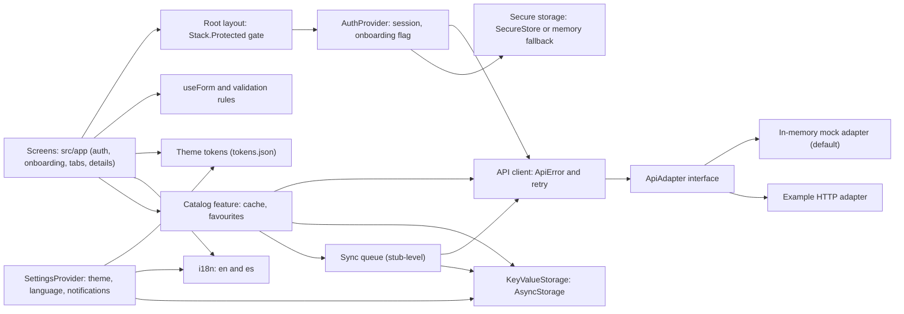

<p align="center"></p>

<p align="center">
  
  
  
</p>

# React Native (Expo) App Starter

> A production-minded Expo starter with authentication flow, navigation, forms, theming and tests.

A TypeScript Expo starter for mobile apps: sign-in and sign-up flow, protected tab and stack navigation, validated forms, light and dark themes, settings, offline storage and a typed API layer with a swappable backend, all covered by tests. The sample brand is "Diamond Empire App Starter" by The Diamond Empire; everything in it (artwork, sample catalog, text) is original.

**Quick links:** [Architecture](#architecture) · [Tech stack](#tech-stack) · [Engineering decisions](#engineering-decisions) · [Quality report](docs/quality-report.md) · [Roadmap](#roadmap) · [Case study](docs/case-study.md)

> **Public showcase.** This repository holds the documentation, client case study, research report and measured results for this product. The runnable source code is distributed separately under a license: see [SOURCE-ACCESS.md](SOURCE-ACCESS.md).

## At a glance

|  |  |
|---|---|
| **Track** | Business · Advanced |
| **Phase** | Beta: all five milestones work, the tests pass from a clean short-path copy, and [docs/quality-report.md](docs/quality-report.md) records the results. Not Live: **the native apps were never run on a device, simulator or emulator** (none exists on the build machine), no real backend has been connected and no customer has used it. |
| **Primary reader** | Clients and founders |
| **Read next** | [Quality report](docs/quality-report.md) · [Client case study](docs/case-study.md) |

## Honest limits, up front

- **Nothing was run on a phone, a tablet, a simulator or an emulator.** What was verified: unit and component tests (Jest with React Native Testing Library), a TypeScript type check, lint, a web export of the app (`expo export`, React Native Web) opened in Chrome and scanned with axe-core, and the byte size of the native JavaScript bundles that `expo export` writes for iOS and Android. Those bundles were exported, never run.
- **Web rendering differs from native.** React Native on the web draws different elements than iOS and Android do, so browser results say little about keyboards, safe areas, gestures, the secure store or performance on a real device.
- **The GitHub Actions workflows (`ci.yml`, `verify.yml`) and `eas.json` were never run.** No EAS or cloud build was started. `eas.json` is a skeleton with no credentials.
- **The backend is an in-memory mock**, and the sync queue is a stub-level pattern. See "Not built yet / out of scope".
- Automated accessibility scans find only part of the problems that affect people. Nothing here claims conformance with an accessibility standard.

## Why this exists

Every mobile app begins with the same weeks of setup: navigation, auth screens, forms, theming and structure. Rushed starts become tangled codebases.

## What it does (built and tested)

- **Sign-in, sign-up and forgot-password screens** with hand-written, validated forms: errors appear after a field is left or a submit is attempted, they are announced as alerts, focus moves to the first invalid field, a double tap cannot send twice. Server errors (wrong password, email taken, rate limit, network) are shown in the chosen language.
- **A typed API layer with a swappable adapter.** Screens depend on one `ApiAdapter` interface. The default is an in-memory mock with fake latency, injectable faults (`mock.failNext('listItems', 'network', 2)`), sign-in lock-out, and optional persistence. A client wrapper turns every failure into a typed `ApiError` and retries repeat-safe calls with exponential backoff (never sign-in or sign-up). An example HTTP adapter shows the shape of a real one; it was tested only against a fake `fetch`.
- **Secure session storage behind an interface.** `expo-secure-store` on devices; an in-memory fallback on web, in tests, or when the module is unavailable. App data (settings, cached user, cached catalog, sync queue) goes to AsyncStorage through a separate interface. The token never goes to the ordinary storage.
- **Tab and stack navigation with protected routes** (Expo Router, `Stack.Protected`): signed-out users reach only the auth screens, signed-in users who have not finished onboarding reach only onboarding, everyone else gets the app. Direct links to a screen you may not open are redirected. Route names are centralised in one file.
- **Onboarding** (three steps, once per user per device) and **settings**: profile edit with validation, theme light, dark or system, language (English or Spanish, or system), notification preferences (**a UI only**: no permission request, nothing sent).
- **Offline-first example feature**: a sample catalog shows the saved copy first, then asks the server; pull to refresh; loading, empty and error states with retry; a "saved data" notice when the server cannot be reached; favourites update at once and are queued when offline, then replayed from the Sync tab (**stub-level**, see below).
- **Design tokens** in one JSON file (light and dark palettes, spacing, radius, type sizes), read by the app and by the contrast script.
- **i18n scaffold** with two languages, typed keys (the Spanish file does not compile without the same keys as English) and a test that placeholders match.
- **Accessibility work that is tested at component level**: roles, labels and states on every control, errors as live alerts, 48 point touch targets, text that follows the system font size with per-variant growth caps, rows that stack at large font sizes, decorative art hidden from screen readers.
- **An error boundary** (route level and app level) with a retry button, and **environment config** through `app.config.ts` validated at start (no secrets).
- **Generated artwork only**: SVG sources in `assets/src/`, and a script that draws them in the installed Chrome to produce the app icon, adaptive icon, splash image and favicon. System fonts, no photos, no external requests.
- **Tests:** unit, component and app-level (routing, auth flow, protected-route redirects, settings persistence, theme switching, i18n) with in-memory services; static checks (paths and author rule, licences, THIRD-PARTY.md, ZIP contents, documentation honesty); and browser tests of the web export at 390 and 1280 px wide in light and dark.
- **`npm run package`** builds the customer ZIP (source, tests and guides, without `node_modules` or build output). Customer guides are in `docs/guide/` and `START-HERE.md`.

## Architecture



## Tech stack

| Layer | Technology used |
|---|---|
| Framework | Expo SDK 58 (`expo` 58.0.22), React Native 0.88.1, React 19.3.0, Expo Router 58.0.29 (file-based routes in `src/app`), TypeScript 6.0 (strict) |
| State and data | React context providers; a typed API client and adapter interface; `@react-native-async-storage/async-storage` 2.2.0; `expo-secure-store` for the session token |
| Forms and text | Hand-written validation rules and a `useForm` hook (no form library); hand-written i18n (English, Spanish) with `expo-localization` for the device language |
| Artwork | Original SVG shapes drawn with `react-native-svg` 15.16.0; system fonts; icon, splash and favicon PNGs generated by a script |
| Web | React Native Web 0.21.4 (`expo export --platform web`, single-page output) used as a build and browser check |
| Testing | Jest 30 with `jest-expo` and React Native Testing Library 14.1; `node --test` for static and browser tests; axe-core 4.14.0 in the installed Chrome driven by `playwright-core` 1.64.1; ESLint with `eslint-config-expo`; TypeScript |
| Delivery | `eas.json` skeleton and two GitHub Actions workflows (never run); `adm-zip` builds the customer ZIP |

## Engineering decisions

### The backend is an interface

Screens depend on one typed `ApiAdapter`. The mock implements it with fake latency and errors you can inject in tests; replacing it means writing one adapter and changing one function (`createApi` in `src/api/index.ts`). A test suite shows how to test an adapter against a fake `fetch`.

### Retry only what is safe to repeat

The client retries reads and repeat-safe writes (favourites, profile update, sign-out, password reset) with backoff, and never sign-in or sign-up: a retry after a lost response could create a second account or hit a rate limit.

### Protected routes through the router, not through screens

`Stack.Protected` removes whole screen groups while their guard is false. Addresses a user may not open land on the not-found route, which redirects known screens to where the user belongs and shows "not found" only for addresses nobody has. The root `index` route redirects `/` the same way.

### Tab content leaves the keyboard order when hidden

axe-core found that the tab navigator keeps inactive tab screens in the page on the web, so their controls stayed in the tab order. Each tab screen wraps its content in `FocusGate`, which hides it (and keeps its state) when the tab is not focused. Screens opened on top of the tabs draw their own Back button and heading inside the page so that every screen has one landmark.

### Honest test boundaries

Tests cover logic and components with in-memory services. A web export proves the app builds and runs in a browser. Device-specific behaviour (secure store, keyboard, safe areas, gestures, performance) is untested. The native bundles are measured, not run.

## Quality bar

Measured by `npm run measure` and `npm run test:record`, with results in the [quality report](docs/quality-report.md):

- Type check, lint and all tests pass from a fresh install in a clean copy at a short path
- Zero axe-core violations on every scanned screen of the web export at 390 and 1280 px wide, light and dark (axe-core covers only part of what matters for accessibility)
- Contrast ratios computed from the design tokens pass their minimums in both themes
- Exported bundle sizes stay within budgets that were written before any export was run
- No third-party requests, no tracking code, no absolute local paths, no secrets in the repository
- Production dependencies have permissive licences at the top level; licences outside the permissive set in Expo's dependency tree are listed in `THIRD-PARTY.md`

## Not built yet / out of scope

- **Running on a device, simulator or emulator.** Not possible on the build machine. Secure store, keyboard handling, safe areas, gestures, notifications and performance are untested on real hardware.
- **A real backend.** Only the in-memory mock exists. The HTTP adapter is an example tested against a fake `fetch`; token refresh and revocation are not implemented.
- **A finished sync engine.** The queue is stub-level: it persists, orders and de-duplicates changes, but it syncs only when the user taps the button; there is no automatic sync, background task or conflict handling.
- **Notifications.** The preferences screen stores choices only; no permission request, no push, no email.
- **Account deletion, email verification, social sign-in, biometrics.** Not built. Both stores have rules about account deletion; add it before publishing an app with accounts.
- **EAS builds, store submission, OTA updates.** `eas.json` is a skeleton; nothing was built or submitted. The guides explain the steps and say they are untested here.
- **Screen reader, Firefox, Safari and real-device testing**, tests at 200 percent zoom, and right-to-left languages.
- **Large system fonts on a device.** Dynamic type behaviour is tested by simulating the font scale in component tests; it was not seen on a phone.
- **Typed route strings** (the Expo Router typed-routes experiment). Route names are centralised in `src/navigation/routes.ts` instead.
- **A form library.** Validation is hand-written (a few hundred lines) to keep dependencies small.
- **Client results.** `docs/case-study.md` keeps its Results table blank: it is for measured engagements, and none has happened.
- **The GitHub Actions workflows have not been run.** They use the same commands as local development, but the project was built and verified locally only.

## Roadmap

- [x] M1: project structure, theme tokens, navigation skeleton
- [x] M2: authentication flow against the mock backend
- [x] M3: forms, validation and settings screens
- [x] M4: typed API layer, offline storage and an example feature
- [x] M5: test suite, web export check, documentation and CI

## Getting started

> _These instructions refer to the source package, which is distributed separately and is not part of this showcase repository._

Requirements: Node 22 or later (the build machine used Node 25, which npm warns about; Expo's own tooling lists 22.13+ and 24.3+ as supported) and Google Chrome or Microsoft Edge installed for the browser checks (nothing is downloaded).

To use the app you only need the source: install and start it.

```text
npm ci
npm start
```

Scan the QR code with Expo Go, or press `w` for the web version. Demo account (mock backend only): `demo@example.com` with `Diamond-123`.

To work on the project and repeat every check from a clean checkout (these are the commands run for the final verification):

```text
npm ci
npm ci --prefix tools
npm run check:paths
npm run contrast
npm run licenses
npm run typecheck
npm run lint
npm test
npm run export:web
npm run test:static
npm run test:web
npm run package
npm run measure
npm run test:record
npm run report:table
```

The first install is slow. `npm run measure` runs every measurement once (two `expo export` runs, then one Chrome through all flows) and writes `results/*.json`. `npm run test:record` runs the whole suite once and records the counts. `npm run report:table` regenerates the results table in the quality report from `results/`. `npm run package` writes `dist/expo-app-starter-0.1.0.zip`.

## Verification

> _These instructions refer to the source package, which is distributed separately and is not part of this showcase repository._

| Command | What it checks |
|---|---|
| `npm run typecheck` | TypeScript, strict mode |
| `npm run lint` | ESLint with the Expo rules |
| `npm test` | unit, component and app-level tests (Jest, React Native Testing Library): API adapter and its error paths, retry, validation, storage and secure-storage fallback, sync queue, settings persistence, theme switching, i18n, protected-route redirects, the auth flow, the catalog, the sync tab |
| `npm run test:static` | paths and author rule, third-party URL and tracking scans, assets, contrast from tokens, licences, THIRD-PARTY.md, ZIP contents, CI files, README and quality report consistency |
| `npm run export:web` then `npm run test:web` | the web export in Chrome at 390 and 1280 px wide, light and dark: axe-core on every screen, flows, theme, redirects, no third-party requests |
| `npm run measure` | all measurements once, raw output in `results/` |
| `npm run test:record` | runs every suite once and records the counts in `results/test-run.json` |
| `npm run contrast`, `npm run licenses`, `npm run check:paths`, `npm run assets` | single checks on their own |

The final verification was run from a clean copy at a short path (`npm ci`, then the commands above) with its outputs written outside the copy; see the [quality report](docs/quality-report.md) for results and limits.

## Repository layout

> _These instructions refer to the source package, which is distributed separately and is not part of this showcase repository._

```text
src/app/                 screens (Expo Router): auth, onboarding, tabs, details
src/api/                 the ApiAdapter interface, mock adapter, HTTP example, retry client
src/auth/                AuthProvider: session, sign-in and sign-up, onboarding flag
src/features/catalog/    the example feature: list, cache, favourites
src/storage/             key-value storage, secure storage with fallback, JSON helpers
src/sync/                the offline sync queue (stub-level)
src/settings/            theme, language and notification preferences
src/theme/               design tokens and the theme provider
src/i18n/                English and Spanish text
src/validation/          form rules and the useForm hook
src/ui/                  shared components, states, error boundary, artwork
src/config/              reads and validates the settings from app.config.ts
src/core/                services: storage, API and sync queue wiring
src/navigation/          route names, navigation theme, entry route
src/hooks/               large-text detection
assets/                  generated icon, splash and favicon PNGs; SVG sources in assets/src/
tests/unit/              logic tests
tests/components/        component tests
tests/app/               app-level tests through the router
tests/helpers/           in-memory services and render helpers
tests/static/            static, documentation and ZIP checks
tests/web/               browser tests of the web export
tests/budgets.json       bundle budgets, written before the first export
tools/                   icon generation, checks, measurements, packaging (maintainer tooling, own package.json)
docs/guide/              customer guides (in the ZIP)
docs/quality-report.md   what was measured and what it means
docs/case-study.md       client case study (results table intentionally blank)
results/                 raw measurement output, screenshots and the generated summary
app.config.ts            Expo config (name, plugins, public extra values)
eas.json                 EAS build profiles skeleton, no credentials
.env.example             the public settings you may change
START-HERE.md            first page of the customer package
THIRD-PARTY.md           libraries, licences and licences to review
CHANGELOG.md             changes
SECURITY.md              security notes
.github/workflows/ci.yml  customer CI definition (never run)
.github/workflows/verify.yml  maintainer checks (never run)
```

## Skills demonstrated

`React Native and Expo` · `TypeScript architecture` · `Mobile navigation and auth flows` · `Accessibility on mobile` · `Component testing` · `Backend-agnostic design`

## One project, three lenses

The same project is documented for three audiences, so one body of work serves every goal.

| If you are… | Read | You will find |
|---|---|---|
| Hiring or reviewing engineers | [This README](README.md) | Architecture, trade-offs, quality bar and what I would defend in a design review |
| A client or founder | [Client case study](docs/case-study.md) | The business problem, the value levers, how it is measured and how an engagement runs |
| A researcher or technical reviewer | Not applicable | This project is judged on its case study and its tests rather than an experimental study |

## Author

Built by **[The Diamond Empire](https://thedempire.shop/)**.
