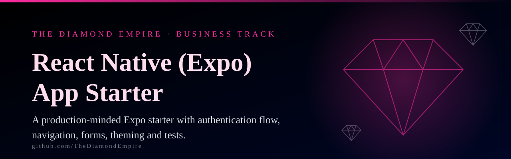

# React Native (Expo) App Starter: Client Case Study

> Skip the setup weeks and start building the product on a tested foundation.

> **Status of this document.** This is a reference case study: it sets out the business problem, the solution and the value model. The results table is intentionally blank and is filled in only from measured data (a pilot or a real engagement). No outcome figures are claimed here.

## Snapshot

|  |  |
|---|---|
| **Who it is for** | Founders, agencies and small teams building mobile apps who want to start from a sound foundation. |
| **Solution** | A production-minded Expo starter with authentication flow, navigation, forms, theming and tests. |
| **Track** | Business · Advanced |
| **Delivered by** | The Diamond Empire |

## The challenge

Weeks go into app plumbing before any product feature exists, and rushed starts accumulate technical debt.

## The solution

A TypeScript Expo starter for mobile apps: sign-in and sign-up flow, tab and stack navigation, validated forms, light and dark themes, settings, offline storage and a typed API layer with a swappable backend, all covered by tests.

What the client gets in practice:

- Authentication flow (sign-in, sign-up, sign-out, password reset screens) against a swappable backend interface with a local mock
- Tab and stack navigation with central route names and protected (signed-in only) screens
- Validated forms with accessible error messages
- Light and dark themes from a token system; scalable text; screen-reader labels
- Settings, profile and onboarding screens; offline-safe local storage

## How it creates value

| Value lever | How the solution delivers it | How we measure it |
|---|---|---|
| Time to first feature | Auth, navigation, forms and theming already exist | Days to the first product screen |
| Code quality | Typed, modular and tested from day one | Defects found in the first release |
| Backend flexibility | Swappable backend interface | Cost of changing backend |
| Accessibility | Labels and scalable text from the start | Accessibility issues found in review |

## How an engagement runs

| Phase | What happens |
|---|---|
| Plan | Screens and backend |
| Customize | Brand and navigation |
| Connect | Backend adapter |
| Hand off | Walkthrough and tests |

## What the client receives

- Starter customized with the client’s brand and navigation
- Backend adapter for the client’s API
- CI pipeline
- Team walkthrough

## Results

Baseline measurements are taken **before** the solution goes live, and the same measures are taken after, so every change in the table is attributable and honest.

| Measure | How measured | Baseline | After | Change |
|---|---|---|---|---|
| Time to first feature | Days to the first product screen | — | — | — |
| Code quality | Defects found in the first release | — | — | — |
| Backend flexibility | Cost of changing backend | — | — | — |
| Accessibility | Accessibility issues found in review | — | — | — |

> **To fill in:** replace each — with measured values and add the measurement window and sample size beneath the table.

## How quality and risk are managed

- Type check, lint and all unit and component tests pass from a fresh install
- The Expo web export builds and is driven through the main flows in a real browser with an automated accessibility scan (which finds only part of the problems a person would meet); the native apps are not run on a device here
- Accessibility labels and roles are asserted in component tests
- No secrets or API keys in the repository

## Is this a fit?

Best suited to: founders, agencies and small teams building mobile apps who want to start from a sound foundation.

## Talk to me

Want this adapted to your business? Get in touch via **[thedempire.shop](https://thedempire.shop/)**.

---

[README](../README.md) · [Client case study](case-study.md)
